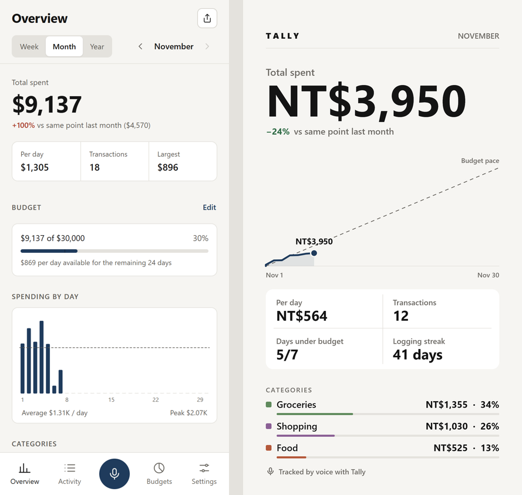

# Tally – voice expense tracker

Say *"lunch 120 and taxi 250 yesterday"* and both expenses are saved, categorised and dated.
Installable web app (PWA) for iPhone and Android, works offline, data stays on the device.

**Live:** https://juw12.github.io/tally/  ·  **Try it with sample data:** https://juw12.github.io/tally/?demo=1 (nothing is saved)

## Features
- **Voice capture** – tap the mic and talk, or use your keyboard's dictation (iOS, Gboard, Wispr Flow).
  Works on iPhone home-screen apps and Firefox too: where the phone's own speech service is missing or silent, Tally records the clip itself and its speech server (Whisper on Cloudflare Workers AI, `api/worker.js`) writes it down. Audio is sent only while you record and is not stored.
  Several expenses per sentence; live preview while you speak; Edit / Undo after saving.
- **Understands English, Bahasa Indonesia and Chinese** – `120`, `$12.50`, `1,250`, `1.250.000`, `50k`, `50rb`,
  `2 juta`, `1.5萬`, "twenty five"; yesterday / kemarin / 昨天, "3 days ago", 前天 …
- **Overview** – week / month / year totals, change vs the same point last period, per-day average,
  budget pace, daily chart (tap a bar to see that day), categories, top spending, recent.
- **Activity** – search, category filter, grouped by day, tap to edit.
- **Budgets** – monthly total and per category.
- **Regions** – 21 regions set currency, number/date format, voice language, week start and app language
  (English, Bahasa Indonesia, 繁體中文, 简体中文); each can be overridden.
- **Share card** – Strava-style image of your real day / week / month: story or square, 8 colour and gradient backgrounds, a transparent sticker (PNG) or your own photo,
  optional *hide amounts*. Shares through the phone's share sheet.
- **Data** – CSV export, JSON backup / restore, persistent storage request, works offline.

## Install on your phone
- iPhone (Safari): open the link → Share → *Add to Home Screen*.
- Android (Chrome): open the link → menu → *Install app*. Long-press the icon → **Record** opens straight into listening.

## Hands-free with Siri
Shortcuts app → new shortcut "Log expense": **Dictate Text** → **URL Encode** → **Open URLs**
`https://juw12.github.io/tally/?add=` + *URL Encoded Text*. Then say "Hey Siri, log expense".

## Development
Plain HTML/CSS/JS, no build step. Serve the folder with any static server.
Checks live in `_check/` (Playwright, Python): `audit_all.py` (WCAG/tap/overflow gates on 77 screens),
`shoot.py`, `shoot_share.py`, `gates_extra.py` (flows, regions, parser, PWA cache).

## Licence
MIT
